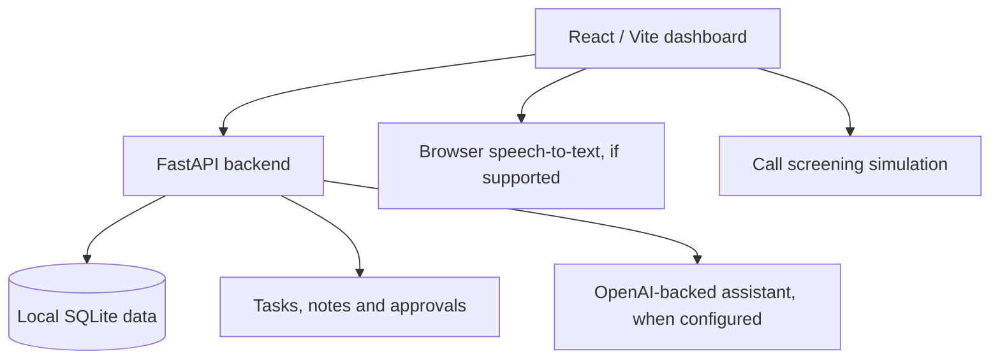

# Vivian — Digital Personal Assistant

[](#important-limitations--roadmap) [](https://jaividhyarthi.github.io/jv-portfolio)

## Architecture at a glance



> This diagram describes the **development build**, not functioning carrier-level telephone handling or unattended external actions.


Local-first, warm ivory-and-sage digital assistant with a React/Vite dashboard and a FastAPI/SQLite backend. **This is a tested development build, not a fully autonomous production phone agent.**

## Features available now

- Two-space (personal/professional) OpenAI-backed chat; explicit local task and note tool calls
- Tasks, notes, explicit memory vault, contacts with trusted flags, reminders (stored only), call records, approvals, activity feed, preferences and JSON export
- Browser speech-to-text on supported browsers, local call screening **simulation**, and integration-status dashboard
- Non-destructive SQLite table migrations; local-first data stored in `backend/vivian.db`
- No real outgoing actions without configured provider and consent

## Requirements

Python 3.11+ and Node.js 20+. OpenAI API key and separate paid API credits for AI replies.

## Run — two terminals (Windows PowerShell recommended for frontend)

**Backend (PowerShell):**

```powershell
cd backend
py -m venv .venv
.\.venv\Scripts\Activate.ps1
python -m pip install -r requirements.txt
Copy-Item ..\.env.example ..\.env
# Edit ..\.env with OPENAI_API_KEY; do not commit secrets.
python -m uvicorn main:app --reload --port 8000
```

**Backend (WSL Bash alternative):**

```bash
cd backend
python3 -m venv .venv
source .venv/bin/activate
python -m pip install -r requirements.txt
cp ../.env.example ../.env
# Edit ../.env; then:
python -m uvicorn main:app --reload --port 8000
```

**Frontend (second Windows PowerShell terminal):**

```powershell
cd frontend
npm install
npm run dev
```

Open http://localhost:5173. Backend docs: http://localhost:8000/docs. **If using WSL 1, run frontend in Windows PowerShell** to avoid Windows Node.js/WSL compatibility errors.

## Security and data

- Never commit `.env`, credentials, call recordings or SQLite database files. `.gitignore` excludes them.
- The default local development setup has no production-grade authentication. Do **not** expose port 8000 or 5173 to the internet.
- `VIVIAN_API_TOKEN` is an optional development guard, but the browser needs a matching token; it is **not** secure public authentication.
- Database is created on first start. New installations do not need to copy data from old versions.
- `GET /api/export` exports local data. Protect this endpoint; it contains sensitive information.
- User-saved memories are included in AI context; don't store sensitive information you don't want sent to the AI provider.

## Important limitations / roadmap

**Not connected:** real mobile SIM forwarding, purchased phone number, live telephony, call recording, voicemail, live transfer, native Android application, background notifications, Gmail/Calendar/Drive/GitHub OAuth, automatic external actions, device control, wake word, always-on agent, production auth. The call lab is explicitly a simulator. Stored reminders do not trigger OS notifications yet.

For real telephone receptionist service you need an eligible Indian telecom/voice provider, number provisioning, webhook security, call audio streaming, appropriate recording consent and carrier conditional forwarding. None is silently enabled.

## Tests

```bash
cd backend
python -m pip install -r requirements-dev.txt
python -m pytest -q
```

Frontend build: `cd frontend && npm install && npm run build`.

## Repository and development status

This repository is already published at [Jaividhyarthi/Vivian-Digital-Personal-Assistant](https://github.com/Jaividhyarthi/Vivian-Digital-Personal-Assistant). Follow the local setup instructions above to develop or evaluate it. No live hosted production service is claimed.

## Maintainer

[Jaividhyarthi Vivekanand](https://github.com/Jaividhyarthi) · [Portfolio](https://jaividhyarthi.github.io/jv-portfolio) · [LinkedIn](https://www.linkedin.com/in/jaividhyarthivivekanand/)
