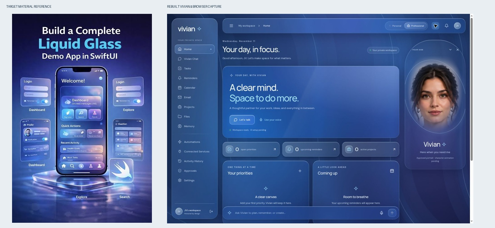
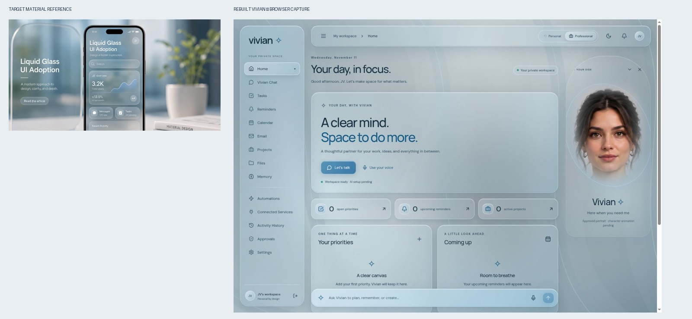

# Liquid Glass reconstruction — 11 November 2026

This rebuild replaces the old material and layout stylesheet; it is not a palette-only patch. The original functional routes and provider configuration remain intact. The two target images were inspected, and the result was compared side by side after a browser refinement pass. This is a desktop translation of the reference material language, not a claim of photorealistic optical refraction or an exact image match.

## Audit and changes

The old canvas used a negative stack level, a pale fixed palette, and only 13% opacity in dark mode. A dark page overlay obscured much of the shader output. Broad flat panels and the attached full-height sidebar further concealed the environment. The first new browser pass also showed that WebGL was unavailable in the QA browser, exposing a static fallback.

The new isolated environment has full-opacity rendering, theme-aware palettes, domain-warped noise and reflective ridges in WebGL, plus an independently animated Canvas2D ribbon renderer when WebGL initialization or shader compilation fails. Both advance without pointer input, cap rendering resolution, pause while the document is hidden, respect reduced motion, and clean up frame loops and resize handlers. Disabling motion freezes the environment rather than removing all material context.

Reusable material styles distinguish clear structural surfaces, more frosted content surfaces, and highlighted controls. Thin reflective borders, inner highlights, contact shadows, blur and saturation replace opaque panels. Navigation floats away from the window edges. The toolbar, dashboard widgets, composer, forms, chat and other pages share the new system. Vivian's approved portrait has a softer multi-axis boundary mask and atmospheric stage; it remains honestly identified as static artwork.

The browser refinement lightened/desaturated the blue-gray daytime palette, strengthened secondary text contrast, removed the portrait's hard top boundary, and softened the hero reflection. The command composer submits through the existing real chat function. Development startup now reports and shuts down the stack if the reminder worker exits or any child fails to start, instead of silently continuing without that service.

## Reference comparison

| Criterion | Observed result and limits |
| --- | --- |
| Color atmosphere | Dark blue/indigo/cyan replaced flat purple. Light silver/blue-gray replaced lavender. |
| Transparency | Environmental fields remain visible through panels; content has stronger frosting for readability. |
| Lighting | Broad cyan and violet fields in dark; diffuse silver-blue in light. |
| Reflections | Layered highlights and thin reflective edges; visual approximation, not physical ray tracing. |
| Spatial depth | Detached navigation, raised toolbar, distinct panel densities and contact shadows. |
| Background visibility | Flowing ribbons are visible between and through surfaces. |
| Motion | Verified in Canvas2D with unchanged UI at two capture times; WebGL visual acceptance remains pending. |
| Typography | Consistent Manrope/DM Sans hierarchy; functional labels remain readable. |
| Composition | Compact metrics, task/reminder widgets, persistent command bar and separate character stage. |
| Overall resemblance | Substantially closer to the reference palettes/material cues; does not reproduce the phone scene, room photo, promotional text or 3D platform. |




## Validation and reproducible evidence

- `npm run build` in frontend: passed.
- `npm test` in frontend: 11 passed, including fallback motion/freeze/cleanup and voice interruption tests. Doubles are used only in automated tests.
- `python -m pytest -q` in backend: 19 passed; two dependency deprecation warnings.
- Browser inspected desktop dashboard in both themes, chat, Settings, task form, and hide/minimize/motion controls. A development-only task was created and observed after reload in the first review. No production/user database was used.
- Actual browser viewport: 1363×936 CSS pixels. Captured JPEGs are 1348×926 pixels. The supplied laptop screenshots are 1918 pixels wide and include browser/OS chrome. This browser control surface did not expose viewport resizing, so exact same-viewport comparison remains pending. Images were not stretched and presented as exact-size captures.
- The browser used `canvas2d`; WebGL initialization returned no usable context. Shader source and production build are present, but GPU rendering/performance has not been visually certified here.
- Dark screenshots at 14:39:28 and 14:39:45 UTC (17 seconds apart), with no intervening UI interaction: mean absolute RGB channel difference 5.285/255. See `dark.jpg` and `dark-motion-later.jpg`.
- Motion-disabled Settings captures: mean RGB channel difference 0.0. See `motion-disabled-a.jpg` and `motion-disabled-b.jpg`.
- No browser video recorded; still-frame motion evidence is provided. Mobile physical-device QA remains pending.

## Remaining dependencies

Live OpenAI and ElevenLabs calls remain untested in this environment; credentials are deferred and were neither requested nor committed. All previously documented external-service gaps remain pending. Genuine walking, gestures, blinking, facial rigging and lip-sync require an approved rig and animation clips; no new face or simulated character movement was generated. See CHARACTER_ANIMATION_STATUS.md for that asset contract.

## Update on Windows

From any current directory:

```powershell
cd "$env:USERPROFILE\Vivian-Liquid-Glass"
git switch development/vivian-liquid-glass
git pull --ff-only origin development/vivian-liquid-glass
$env:PYTHON = (Resolve-Path .\.venv\Scripts\python.exe).Path
cd frontend
npm ci
npm run dev
```

Open http://localhost:5173/. Existing backend `.env` configuration stays local. Do not copy the development QA bypass into a real deployment.
